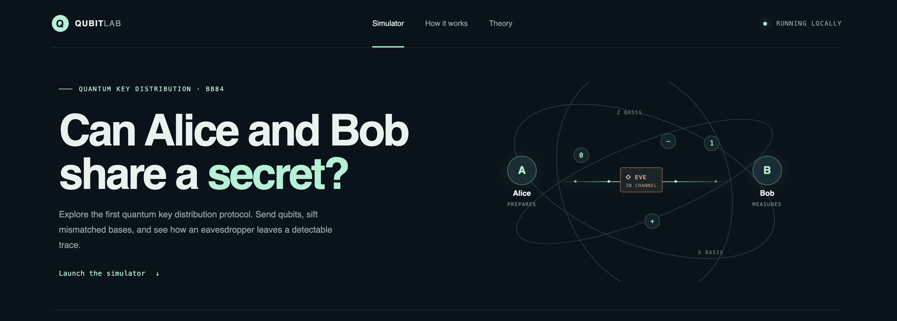
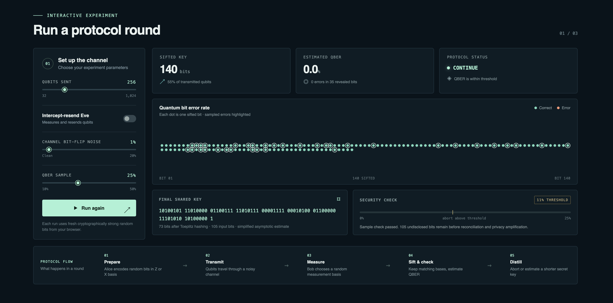

# Qubit Lab — BB84 Simulator

A standalone, browser-based learning project for the BB84 quantum key distribution protocol. It runs locally without a backend, framework, package installation, or external API.

## Screenshots

### Landing page



### Example simulation result



The bit string shown in the screenshot is randomly generated for that run. It is an educational output and must not be used as a real cryptographic key.

## Run locally

Open `index.html` in a modern browser, or open a terminal in this project folder (the folder containing `index.html`) and run:

```bash
python3 -m http.server 8000
```

Then open [http://localhost:8000](http://localhost:8000).

## What it demonstrates

- Random preparation in the Z (rectilinear) and X (diagonal) bases.
- Independent random measurement bases for Bob and basis sifting.
- An optional intercept-resend eavesdropper with adjustable attack probability.
- Channel bit-flip noise, random sample disclosure, and estimated QBER.
- An 11% abort threshold and an illustrative final-key estimate using Toeplitz hashing over GF(2).
- A visual sifted-key plot, protocol flow, state guide, and theory notes.

The simulator uses the browser's Web Crypto random number generator. Simulation data stays in the browser and is not sent to a server.

## Model limits

This is an educational model, not a production QKD implementation. It models channel noise as independent bit flips and Eve only as an intercept-resend attacker. Error correction is assumed after a passing QBER check. The key-length calculation uses a simplified asymptotic estimate with a fixed margin; it is not a composable finite-key security proof. Real deployments also require authenticated classical communication, carefully characterized hardware, finite-size bounds, and complete error-correction and privacy-amplification analysis.

## Project files

- `index.html` — page structure and theory content
- `styles.css` — responsive visual design
- `app.js` — simulation and interface behavior
- `screenshots/` — README screenshots

